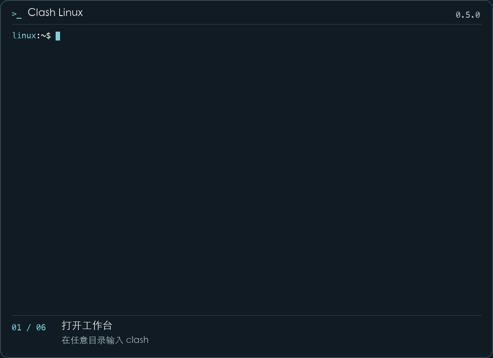
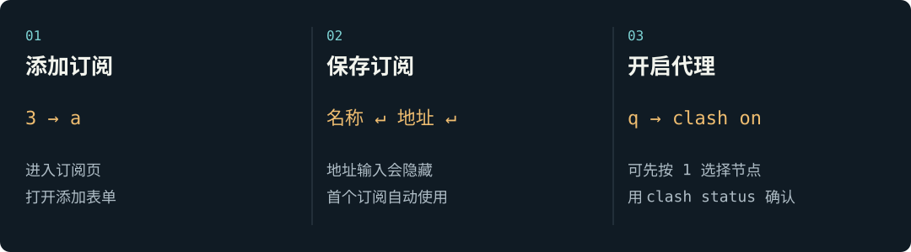

<p align="center">
  
</p>

<h1 align="center">Clash Linux</h1>

<p align="center">在 Linux / SSH 终端管理订阅、节点与代理。</p>

<p align="center">
  <a href="#install">下载与安装</a> · <a href="#start">开始使用</a> · <a href="#help">常见问题</a>
</p>

<picture>
  <source media="(prefers-reduced-motion: reduce)" srcset="docs/assets/terminal-demo.png">
  
</picture>

- **管理订阅**：保存多个订阅，更新内容，按需切换。
- **选择节点**：搜索节点、测试延迟，切换规则 / 全局 / 直连模式。
- **开关代理**：在任意目录输入 `clash` 打开工作台，用 `clash on` 开启当前终端代理。
- **查看状态**：检查核心和当前终端代理，查看连接诊断与实时日志。

<a id="install"></a>

## 下载与安装

当前 Rust 版本为 **0.5.0**，通过 [GitHub Releases](https://github.com/lzt2323/clash/releases/tag/rust-v0.5.0) 分发。运行时无需 Python、Rust、Cargo 或 Node.js。

| 系统 | 选择的安装包 | 运行条件 |
| --- | --- | --- |
| Linux x86_64 / amd64 | [下载安装包](https://github.com/lzt2323/clash/releases/download/rust-v0.5.0/clash-linux-rust-x86_64-unknown-linux-gnu.tar.gz) · [SHA-256](https://github.com/lzt2323/clash/releases/download/rust-v0.5.0/clash-linux-rust-x86_64-unknown-linux-gnu.tar.gz.sha256) | glibc 与 libgcc 系统库；已在 Ubuntu 22.04 验证 |

> [!TIP]
> 一键安装会自动下载并校验对应架构的程序，默认安装到 `~/.local/share/clash-linux-rust`，无需 sudo。安装后，当前窗口按提示执行一次 `source`；以后新开终端直接输入 `clash` 即可。

### 一键安装

```bash
curl -fsSL https://clash.lzt23.com/install.sh -o /tmp/clash-install.sh && bash /tmp/clash-install.sh
```

再次运行会保留订阅和核心，调用 Rust 升级流程。自定义目录及离线安装见[安装说明](rust/README.md#一键安装)。

### 手动安装

先使用随包提供的 `.sha256` 文件校验压缩包，再解压：

```bash
sha256sum -c clash-linux-rust-x86_64-unknown-linux-gnu.tar.gz.sha256
mkdir -p clash-linux-package
tar -xzf clash-linux-rust-x86_64-unknown-linux-gnu.tar.gz -C clash-linux-package
cd clash-linux-package
./clash self-install --prefix "$HOME/.local/share/clash-linux-rust"
source "$HOME/.local/share/clash-linux-rust/env.sh"
```

首次安装会下载并校验 Mihomo 核心；相同版本可复用，之后升级管理程序无需再次下载核心。已有核心、离线安装及旧数据迁移见[安装说明](rust/README.md#安装与运行)。

<a id="start"></a>

## 开始使用

### 添加订阅并开启代理



1. 输入 `clash` 打开工作台，按 **3** 进入订阅页，再按 **a** 添加。
2. 填写订阅名称，按 **Enter**；粘贴 Clash / Mihomo YAML 订阅链接，再按 **Enter**。地址输入会隐藏，首个订阅自动使用。
3. 按 **1** 进入节点页，使用 **↑ / ↓** 选择节点，按 **Enter** 应用；也可以保留“自动选择”。
4. 按 **q** 返回终端，执行 `clash on`，再执行 `clash status`。

看到“核心：运行中”和“当前终端代理：已开启”，即完成首次配置。新开的 Bash / Zsh 终端可在任意目录输入 `clash`；每个 SSH 会话需要单独执行 `clash on`。

[打开 HTML 分步指南](docs/guide.html)：在本地浏览器打开此文件，可逐步查看首次配置的按键和界面变化。

### 常用 CLI 命令

| 命令 | 用途 |
| --- | --- |
| `clash` | 打开终端工作台 |
| `clash on` | 启动核心，并开启当前终端代理 |
| `clash off` | 关闭当前终端代理，核心继续运行 |
| `clash status` | 查看核心、代理、订阅和节点状态 |
| `clash start` | 只启动核心，不修改当前终端代理 |
| `clash stop` | 停止核心，并清除当前终端代理 |
| `clash restart` | 重启核心 |
| `clash doctor` | 检查连接并查看诊断结果 |
| `clash logs --follow` | 持续查看核心日志，按 Ctrl+C 结束查看 |
| `clash menu --plain` | 使用数字文本菜单 |
| `clash app-version` | 查看管理程序版本 |
| `clash help` | 查看完整命令帮助 |

`clash on / off` 只影响当前终端；停止或重启核心会影响所有使用该核心的终端。订阅自动更新、配置备份等进阶操作见[完整使用说明](rust/README.md)。

<a id="help"></a>

## 常见问题

**关闭代理和停止核心有什么区别？**

`clash off` 清除当前终端的代理变量，核心继续运行；`clash stop` 停止核心，会影响其他正在使用它的终端。

**为什么添加订阅后，终端仍没有使用代理？**

添加订阅、选择节点只会保存配置。按 `q` 返回终端后执行 `clash on`；如果提示找不到命令，先按安装输出执行一次 `source`。

**只剩一个订阅时能删除吗？**

可以。在订阅页按 `d` 并确认。最后一项删除时会停止核心，之后可重新添加；当前终端若已开代理，请执行 `clash off`。

**如何升级并保留配置？**

Rust 安装可使用 `clash upgrade --archive FILE --sha256 HASH` 离线升级，保留订阅、配置与核心。旧 Python 安装需显式导入数据，不能直接覆盖。[升级与回滚说明](rust/README.md#管理程序升级)。

**支持 macOS、Windows、ARM64 或 Alpine 吗？**

当前提供并验证的是 Linux x86_64 glibc 版本。其他平台尚未提供经过实机验证的安装包。

更多操作运行 `clash help`，或阅读[完整使用说明](rust/README.md)。参与开发请看[开发与验证](rust/README.md#开发与验证)。

许可证：[GPL-3.0-only](LICENSE)。代理核心使用 [Mihomo](https://github.com/MetaCubeX/mihomo)，独立下载。
